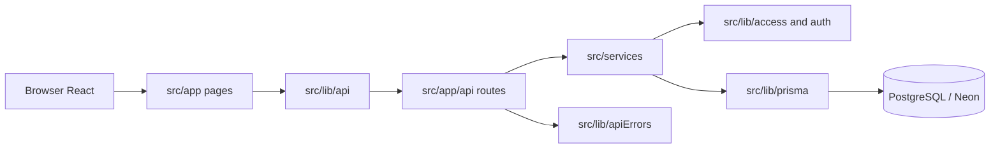
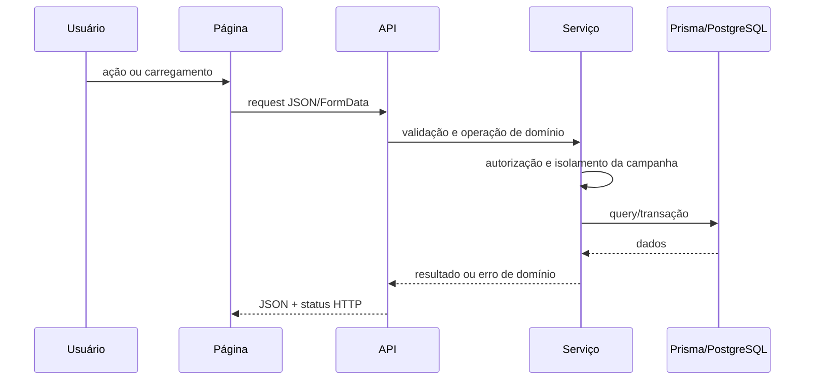

# Arquitetura

## Stack e camadas

- Next.js 14 App Router e React 18 em `src/app`.
- TypeScript estrito com alias `@/*` para `src/*`.
- CSS Modules e tokens globais em `src/styles/globals.css`.
- Rotas HTTP em `src/app/api`; validação com Zod; serviços em `src/services`.
- Prisma Client 5 em `src/lib/prisma.ts` sobre PostgreSQL.
- Vitest para testes unitários e de serviço.

## Organização

`src/app` contém páginas, layouts e handlers; `src/components` contém UI e CSS Modules; `src/lib` contém autenticação, autorização, schemas, regras e cliente Prisma; `src/services` concentra domínio e persistência; `prisma` contém schema e migrations; `scripts` contém smoke tests e verificações de banco.

## Fluxos relevantes

O layout de campanha resolve acesso, campanha e tema publicado antes de renderizar o shell. A edição de arquivo carrega entidade, tags, campanha e opções relacionadas; o auto-save usa debounce. O modo jogador recebe dados filtrados no servidor por publicação, grants e audiência.

## Estado, cache e erros

Não há store global de domínio: páginas server-side e componentes React gerenciam estado local. Não há camada de cache persistente documentada no código; o carregamento inicial e o `router.refresh()` são usados para sincronizar UI. Erros de API passam por `apiErrors.ts`, com mensagens públicas estáveis e logs internos limitados.

## Limitações arquiteturais

- O rate limiting em memória não coordena múltiplas réplicas.
- Uploads de anexos e temas são data URLs; não substituem object storage para arquivos grandes.
- A telemetria é opt-in e baseada em logs, não em métricas persistentes.
- A configuração de Vercel/Neon não está versionada no repositório.
