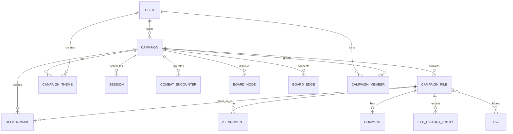

# Banco de dados

## Tecnologia e conexão

O schema Prisma usa PostgreSQL. `DATABASE_URL` é a conexão runtime, preferencialmente pooled no Neon; `DATABASE_URL_UNPOOLED` é `directUrl` para migrations e tarefas administrativas. Os valores reais ficam fora do Git.

## Domínios do schema

Identidade: `User`, `AuthSession`, `CampaignMember`, `CampaignInvite`. Campanha e conteúdo: `Campaign`, `CampaignFile`, `Attachment`, `Comment`, `FileHistoryEntry`, `Tag`, `FileTag`, `FavoriteFolder`, `FavoriteEntry`. Sistemas: `CampaignAttribute`, `CampaignSkill`, `CampaignClass`, `CampaignRace`. Investigação: `RelationshipType`, `Relationship`, `InvestigationHypothesis`, `HypothesisEvidence`, `SessionHypothesis`, `BoardNode`, `BoardEdge`, `InvestigationBoardPin`, `InvestigationBoardGroup`, `InvestigationBoardView`, `SessionBoardView`. Operação: `Session`, `SessionFile`, `TimelineEvent`, `CampaignBriefing`, `CombatEncounter`, `CombatParticipant`. Publicação e auditoria: `PlayerModeConfig`, `PlayerVisibility`, `CampaignFileGrant`, `AuditEvent`. Aparência: `CampaignTheme`, `ThemePreset`.

`CampaignFile` é o modelo polimórfico principal: `type` define a categoria e `data` guarda payload específico em JSON. Relacionamentos oficiais usam `Relationship`; conexões do quadro são visuais e não substituem o grafo oficial.

## Migrations da auditoria

| Migration | Alteração | Tipo |
|---|---|---|
| `20261124150000_campaign_themes` | temas, presets, tema ativo e índices/foreign keys | aditiva |
| `20261124100000_add_3det_victory` | enum `THREEDET_VICTORY` | aditiva |
| `20261124170000_add_campaign_file_list_indexes` | dois índices compostos de `CampaignFile` | aditiva |

Migrations anteriores permanecem na ordem do diretório. Execute `npx prisma migrate deploy` somente com a base correta e autorizada. Não há backup automatizado implementado no código; backup e restore são responsabilidades da infraestrutura PostgreSQL/Neon.

## Integridade e operação

O Prisma define chaves primárias CUID, foreign keys, `onDelete` explícitos, unicidades e índices por campanha. Serviços usam transações para operações que precisam ser atômicas. O cliente Prisma é singleton em desenvolvimento para evitar conexões excessivas no hot reload. A migration de performance não altera dados, apenas cria índices.
